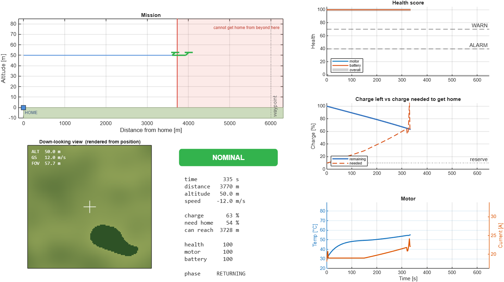
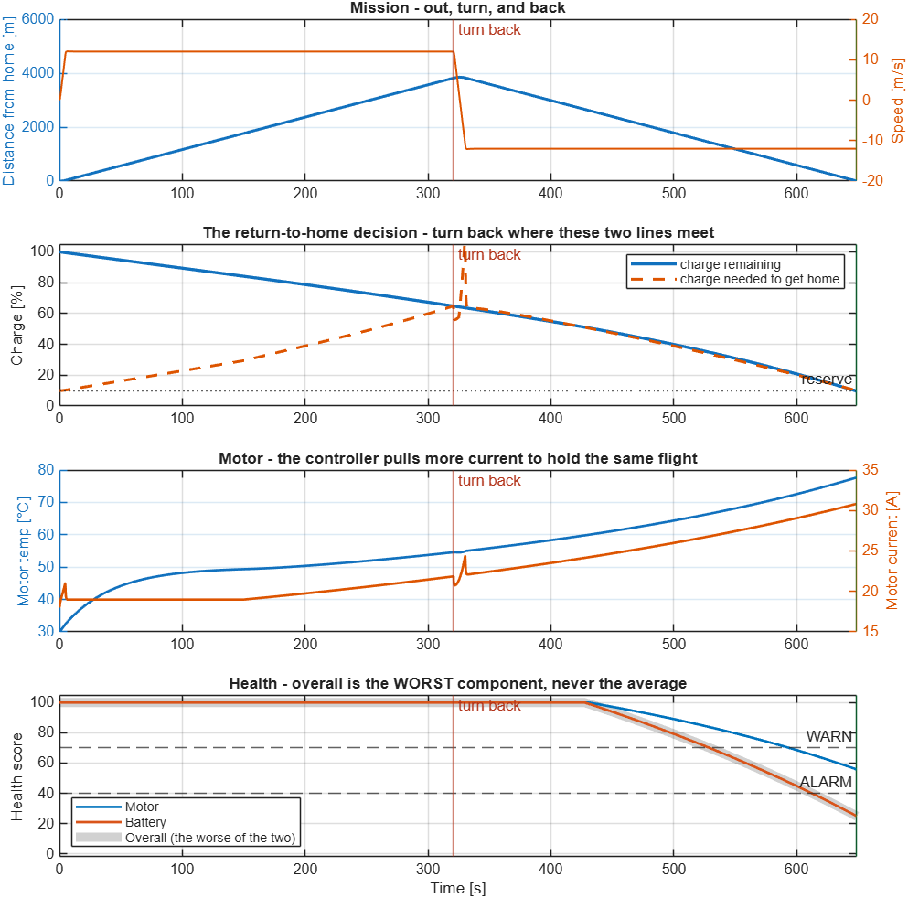
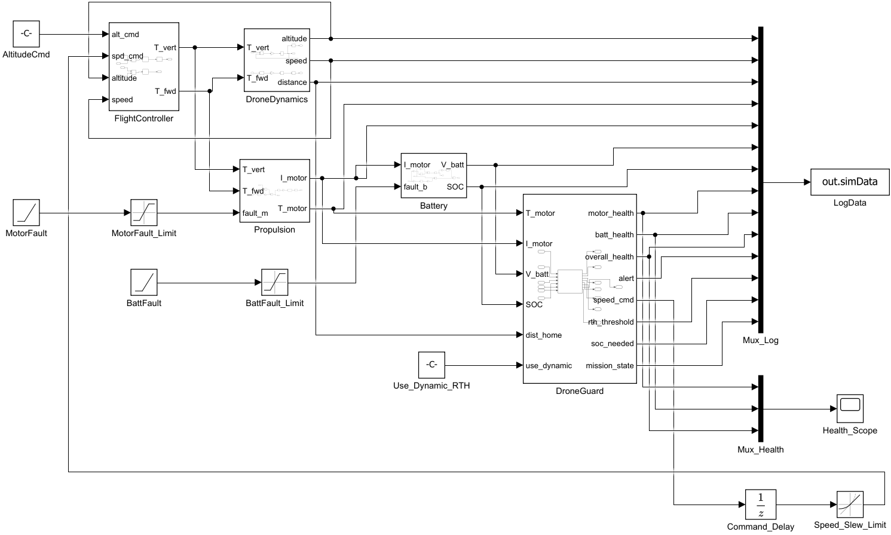
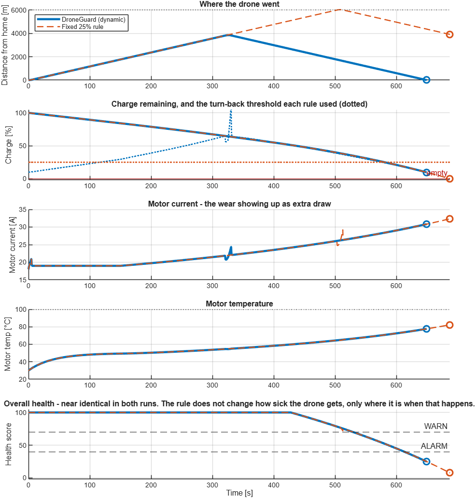

# DroneGuard

**Intelligent drone health monitoring & mission optimisation — Simulink simulation.**

A drone flies an out-and-back mission under closed-loop control while two of its
components slowly wear out. A DroneGuard module attached to it does two jobs:
score the aircraft's health from telemetry, and decide when it must turn around
to get home alive.



*`droneguard_dashboard` — the mission played back. Caught here the moment the
drone turns: it has just touched the red boundary marking everywhere it could
no longer get home from.*



---

## Quick start

Requires **MATLAB + Simulink**. No other toolboxes — verified with
`dependencies.toolboxDependencyAnalysis`, which reports only MATLAB and
Simulink for every file and for the model. Developed on R2026a; R2025a or
newer recommended (older releases work, the plots are just less pretty).

Solver: fixed-step ode3 at 0.1 s — fixed-step because the DroneGuard module
is meant to run on a 10 Hz clock on real hardware.

```matlab
cd <this folder>
startup                     % once per session - puts everything on the path

droneguard_run              % fly one mission and plot it
droneguard_run('fixed')     % same flight, naive fixed 25% turn-back rule
droneguard_compare          % fly both and compare side by side
droneguard_dashboard        % watch the mission play back, with live gauges
droneguard_dashboard('dynamic', Speed=5)   % ...slower. Speed=1 is real time

open_system('DroneGuard_Sim')   % open the block diagram
```

`startup` runs automatically if you launch MATLAB from this folder.

**New to the code?** [`matlab/README.md`](matlab/README.md) is the hands-on guide:
what every plot panel means, how the health score is calculated, and which
numbers to change for what.

To change anything, edit `matlab/sim/droneguard_params.m` (the aircraft) or
`matlab/src/droneguard_thresholds.m` (the module's limits and mission rules) —
never the blocks themselves.

---

## What is in this repo

```
.
├── startup.m                         path setup - run this first
├── matlab/
│   ├── model/
│   │   └── DroneGuard_Sim.slx        the Simulink model
│   ├── src/                          THE ALGORITHM - what would run on a Raspberry Pi
│   │   ├── droneguard_module.m       the whole module - calls the two below
│   │   ├── droneguard_health.m
│   │   ├── droneguard_mission.m
│   │   └── droneguard_thresholds.m
│   └── sim/                          SIMULATION ONLY - never deployed
│       ├── droneguard_params.m
│       ├── droneguard_run.m
│       ├── droneguard_compare.m
│       ├── droneguard_plot.m
│       └── droneguard_missionend.m
└── docs/
    ├── DroneGuard.pdf                the original project deck
    └── images/                       figures used in this README
```

Everything MATLAB-side lives under `matlab/`, leaving room for a `pi/` or
`firmware/` folder beside it when the algorithm is deployed for real.

The `src` / `sim` split inside it is the point of the layout: **everything in
`matlab/src` is plain MATLAB with no toolbox calls and no Simulink dependency**,
so it can be unit-tested on its own and compiled to C for a companion board.
Everything in `matlab/sim` exists only to fly the virtual aircraft and draw
pictures.

### File by file

| File | What it does |
|---|---|
| `startup.m` | Adds `matlab/src`, `matlab/sim` and `matlab/model` to the MATLAB path and prints the available commands. |
| `matlab/model/DroneGuard_Sim.slx` | The model. 17 blocks on the top level, five of them subsystems. |
| `matlab/src/droneguard_module.m` | The whole companion computer in one call: score health, then decide what the mission should do about it. This is the function that would be compiled for the Pi. |
| `matlab/src/droneguard_health.m` | Turns four telemetry numbers into three health scores plus an alert level. The scoring maths. |
| `matlab/src/droneguard_mission.m` | Decides, every cycle, whether there is still enough charge to get home. Owns the outbound / returning / home state. |
| `matlab/src/droneguard_thresholds.m` | Single source of truth for every limit the module uses — health thresholds, pack constants, mission rules. Literals only, so it is safe for code generation. |
| `matlab/sim/droneguard_params.m` | Every number describing the *aircraft*: mass, drag, controller gains, motor constants, battery size, and when each fault starts. |
| `matlab/sim/droneguard_run.m` | One-command entry point: load parameters, simulate, plot. |
| `matlab/sim/droneguard_compare.m` | Flies the identical mission twice — dynamic vs fixed turn-back rule — and plots them together. |
| `matlab/sim/droneguard_plot.m` | The four-panel mission figure and the console summary. |
| `matlab/sim/droneguard_dashboard.m` | Animated playback of a mission: side-on scene, down-looking view, and gauges updating as it flies. |
| `matlab/sim/droneguard_missionend.m` | Finds the sample where a mission genuinely ended (home, or battery empty) so plots do not show meaningless tails. |
| `docs/DroneGuard.pdf` | The original project deck this is built from. |

---

## Architecture

```
  +--- THE AIRCRAFT ---------------------------------------+
  |  AltitudeCmd ----------+                                |
  |  speed cmd -> SlewLimit+-> FlightController -> Dynamics |
  |      ^                          ^                  |    |
  |      |                          +---- feedback ----+    |
  +------|--------------------------+----------------------+
         |                          | thrust demand
  +------|--- THE POWERTRAIN -------v----------------------+
  |      |  MotorFault -> Propulsion -> Battery <- BattFault|
  +------|--------------------------+----------------------+
         |                          | telemetry
  =======|==========================v=====================   <- the attach point
  +------+--- THE MODULE (would run on a Raspberry Pi) ----+
  |                    DroneGuard                           |
  |   telemetry -> health score -> alert -> mission decision|
  |             -> speed command, RTH threshold             |
  +--------------------------------------------------------+
```



The module issues **mission-level** commands only — "fly out", "come home",
"stop". It never touches the inner attitude loop, which stays on the flight
controller where hard real-time actually matters. That is exactly how a
companion computer talks to a Pixhawk over MAVLink, and it is why a Linux board
is a safe place to put this code.

`Command_Delay` (a Unit Delay) sits on the speed command leaving the module. It
is not a hack: it represents the one-cycle latency of a command travelling from
the companion computer to the flight controller, and it is what stops the model
forming an algebraic loop. Putting it on the *output* rather than on the
telemetry input means the module reads all four sensors fresh and consistent.

The two `*_Limit` Saturation blocks clamp fault severity to 0..1. Without them a
steeper fault ramp drives motor efficiency through zero and the simulation dies
with a divide-by-zero — which is exactly what happened the first time the
default parameters were changed.

| Tier | Rate | Runs on | In this model |
|---|---|---|---|
| Flight control | 400 Hz – 1 kHz | Pixhawk / FC | `FlightController` |
| Health + mission | 10 Hz | Raspberry Pi | `DroneGuard` |
| Dashboard | on demand | Ground station | `Health_Scope`, `LogData` |

### Inside the five subsystems

| Subsystem | What it contains |
|---|---|
| `FlightController` | Two PID loops. Altitude error → thrust (plus a constant hover-thrust feedforward). Speed error → forward thrust. |
| `DroneDynamics` | Newton's laws. Force ÷ mass → integrate → speed → integrate → position. Plus aerodynamic drag. |
| `Propulsion` | Thrust demand → current (÷ thrust-per-amp), then current² → heat through a 40 s thermal lag. |
| `Battery` | Current drains a saturating SOC integrator; SOC sets open-circuit voltage; current × internal resistance is the sag. |
| `DroneGuard` | One MATLAB Function block running the entire module — health scoring *and* the mission decision — on a 10 Hz discrete clock. Calls `droneguard_module.m`. |

---

## How the faults work

Both are **Ramp** blocks driving a 0→1 severity signal, because wear develops
gradually. A step change would be a crash, not something worth predicting.

**1. Motor / ESC wear** (from t = 150 s) — severity reduces *thrust per amp*.
Current is never faulted directly. The flight controller still has an altitude
to hold, so it demands the same thrust, which now costs more amps — and those
amps become heat. The closed loop produces the symptom; the fault only removes
efficiency. Current climbs 18 A → 31 A with nothing ever touching the current
signal.

**2. Battery ageing** (from t = 400 s) — internal resistance rises 4×, the pack
drains ~67% faster, and terminal voltage sags below what the SOC predicts.

---

## How the health score works

Each indicator maps linearly onto 0–100 between a "good" and a "bad" limit
(motor temp 60→100 °C, current 28→40 A, voltage sag 0.1→1.5 V).

Component scores fuse with **`min()`, not `mean()`**. Averaging would let a
healthy battery mask a dying motor — precisely the silent failure this project
exists to catch. The score becomes an alert level: 0 OK, 1 WARN, 2 ALARM.

## How health and mission connect

They are one module, not two. The health score is not just reported to the
operator — it is an **input to the mission decision**:

```
telemetry -> health score -> alert level -> mission decision -> speed command
```

There are three independent reasons the module will stop flying away from home:

1. it reached the waypoint,
2. it no longer has the charge to get back (the energy rule, below),
3. **the health score says the aircraft is not fit to continue** (alert = ALARM).

Reason 3 is the one that needs the two halves joined. Consider a motor that
degrades early and hard:

```
turned back at t = 145 s, 1710 m out
  at that moment  SOC = 81%   RTH threshold = 59%
  health = 40, alert = 2, motor temp = 75 C
  outcome: home at t = 298 s with 19% left
```

The energy maths had 22 points of margin and would happily have kept going. The
health score overruled it. Before these were merged the mission logic had no
access to the alert at all, and the drone would have carried on outbound with a
cooking motor.

## How the mission decision works

Every cycle, `MissionManager` asks one question:

> *If I turn around right now, do I have enough charge to get home?*

```
time home   = distance / cruise speed
charge home = expected current x time home
threshold   = charge home / capacity x safety margin + reserve
turn back when  SOC <= threshold
```

The threshold is **not a fixed number**. It rises as the drone flies further
out, and rises again as the motor degrades and draws more current. In the
default run it climbs from 10% at takeoff to 60% by the time the drone turns.

One subtlety that needed fixing: using the current measured *right now*
under-predicts, because the motor keeps degrading during the whole flight home.
The module therefore measures how fast the draw is growing and projects it over
the return trip — and only upward trends count, so it never talks itself into
believing the trip home got cheaper. Without this the drone arrived home at
exactly 0%, straight through its reserve.

---

## Results

```
Turned back : t = 321 s at 3817 m  (ran out of energy margin, not at the waypoint)
Outcome     : HOME at t = 649 s with 10% charge left
```

Same airframe, same faults, same mission — only the turn-back rule differs:

| Rule | Turned at | Outcome |
|---|---|---|
| **DroneGuard (dynamic)** | 3817 m | home with **10%** left |
| Fixed "turn at 25%" | 6001 m (the waypoint) | **battery dead 3910 m from home** |



The fixed rule is not obviously stupid — 25% sounds cautious. It fails because
it answers *"how much is left?"* when the question that matters is *"is what is
left enough to get back, given how this drone is behaving today?"*

Look at the lower three panels of that figure: **current, temperature and health
are near identical in both runs.** The turn-back rule does not change how sick
the drone gets — it only changes how far from home it is by the time that
happens. Both drones end the flight in poor health; only one of them ends it on
the ground at home.

Worth noting separately: during the healthy phase the altitude and speed traces
are **flat lines**. The controller compensates perfectly for the degrading motor
right up until it cannot. From the outside the drone looks fine while its
current draw doubles — the "fails silently" claim from the deck, reproduced as a
result rather than asserted on a slide.

---

## Known limitations

- The model does not cut thrust when the pack hits 0%, and there is no ground to
  land on. Plots and summaries therefore stop at the real mission end (home, or
  empty) — anything after that is an artefact of the model, not a prediction.
- Telemetry is perfect: no sensor noise, no dropouts. The health score has an
  easier job here than it would on real hardware.
- One "motor" stands for all four. No per-rotor faults, no propeller imbalance
  or vibration spectrum analysis.
- Motion is longitudinal and vertical only — no yaw, roll or wind.

## Possible next steps

1. **Sensor noise** — the highest-value addition. Both modules currently read
   flawless data, which is the least realistic thing about the simulation.
2. **Propeller imbalance** — inject a rotor-frequency vibration and score it
   from the accelerometer spectrum. Needs IMU logging at ≥ 400 Hz.
3. **Processor-in-the-loop** — generate C from `matlab/src/` onto a Raspberry Pi and
   run it against this model over the network.

---

*Perinba Athiban.S (23BRS1322) · R. Rithvik Nimal (23BRS1377) · S Sarvesh (23BRS1380)*
