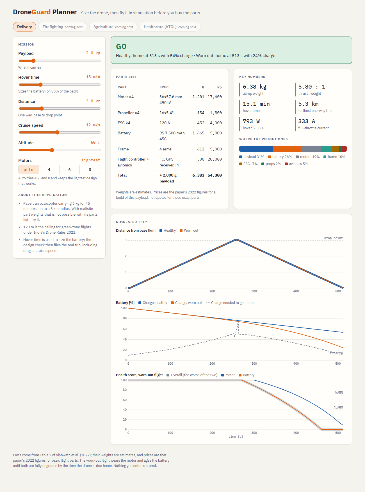
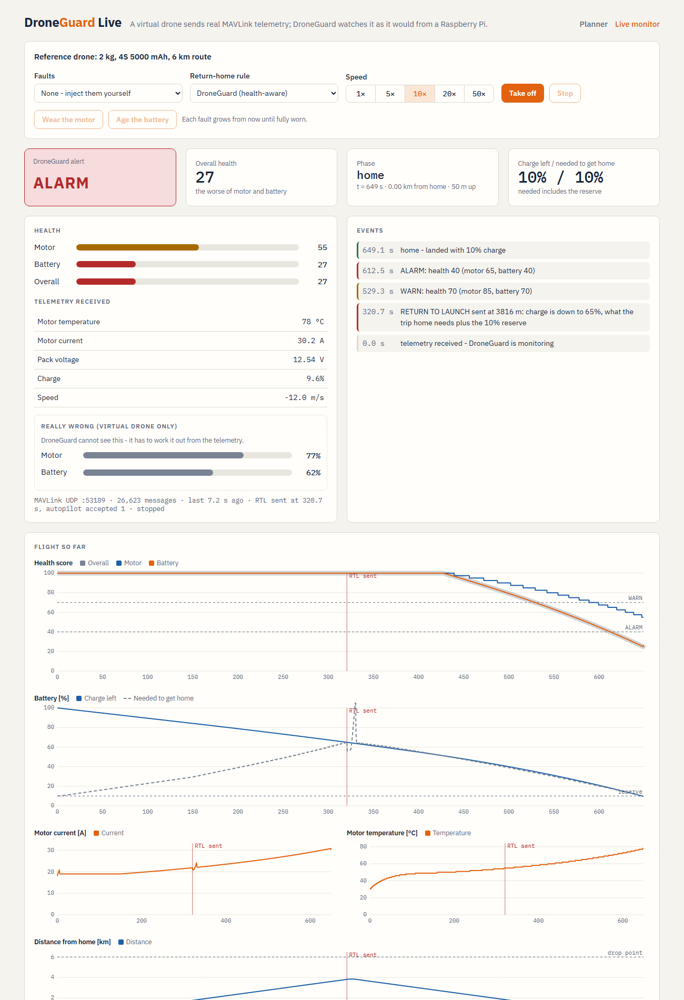

# DroneGuard — Python version

This is the same DroneGuard as the MATLAB folder: the health score, the
return-home decision and the simulated drone, rewritten in Python. The website
and the live monitor need Python. The Simulink model stays the **reference**,
and the Python version has to give the same answers.

## The planning website



```bash
cd python
python -m venv .venv                         # once
.venv\Scripts\python -m pip install -r requirements.txt   # once
.venv\Scripts\python -m web                  # then open http://127.0.0.1:8000
```

Pick **Delivery** and move the sliders: payload, hover time, distance, cruise
speed, altitude, motor count. Every change re-plans in about a second:

- **Verdict**: GO / GO WITH CAUTION / NO-GO, or CAN'T BUILD IT when no parts in
  the list can do the job
- **Parts list**: motor, propeller, ESC, battery, frame, flight controller,
  with estimated weights
- **Key numbers**: weight, thrust : weight, hover time, furthest trip, power
- **Simulated trip**: distance, battery charge vs charge needed to get home,
  and the health score during the worn-out flight

Only Delivery is shown for now. Firefighting, agriculture and healthcare are
defined in `droneguard/applications.py` and appear once they're marked
available. Nothing you enter is saved.

## The live monitor



With the website running, open **http://127.0.0.1:8000/live** and press **Take off**.
You can also press **Fly it live** in the planner to fly the drone you just designed.

Two programs run, joined by real **MAVLink over UDP**, the language a Pixhawk speaks:

- a **virtual drone**: the simulated drone, plus an autopilot that flies out to the drop point and back and obeys "return to launch"
- **DroneGuard**: sees only the telemetry (motor temperature and current, battery voltage and charge used, position), works out the health score 10 times a second, and sends `RETURN_TO_LAUNCH` when the drone must turn back

Press **Wear the motor** or **Age the battery** mid-flight to watch DroneGuard
notice and react. The "really wrong" box shows the true fault level, which
DroneGuard never sees.

The same two programs also run in two terminals. This is how it will run beside
a real flight controller:

```bash
.venv\Scripts\python -m live.monitor --connect udpin:127.0.0.1:14550    # DroneGuard
.venv\Scripts\python -m live.drone --port 14550 --speed 10 --faults     # the drone
```

On the Raspberry Pi, the monitor reads the flight controller's serial port
instead. See [docs/hardware.md](../docs/hardware.md).

## Run it from the command line

```bash
cd python
pip install -r requirements.txt

python -m droneguard              # one mission, health-aware return-home
python -m droneguard fixed        # same mission, naive "turn back at 25%" rule
python -m droneguard compare      # both
python -m droneguard compare --plot   # with graphs
```

One mission takes under half a second.

## Size a drone (what parts do I need?)

```bash
python -m droneguard.sizing --payload-kg 2 --endurance-min 15
python -m droneguard.sizing --payload-kg 6 --endurance-min 15 --motors 6
python -m droneguard.sizing --paper-cases      # the paper's seven builds, checked
```

You say what it must carry and how long it must hover. It picks the motor,
propeller, ESC and battery, and gives the total weight, thrust, currents and a
cost estimate. It uses the method from `7.Component selection.pdf`, with one
fix: the paper guesses the drone's weight once. Here the engine adds up the
real parts, finds the weight went up, and sizes again until it stops changing.

It follows these rules:

- motors at full throttle must make **2× the drone's weight** (the 2:1 rule)
- an **ESC** never runs above 80% of its rating
- hovering for the asked time uses only **80% of the battery**
- the battery's **C rating × capacity** must cover every motor at full throttle

If nothing in the parts list can do the job, it says why and how far off it is.

What it found in the paper:

- Table 3's "power required" is 13–54× more than its own parts can draw (2 kg drone: claims 46,518 W, the parts top out at 960 W)
- the firefighting battery (6S 1200 mAh 15C) gives 18 A, but eight motors need at least 128 A
- once real part weights are counted, its 15–30 kg builds have no motor in the list strong enough

The parts list is the paper's Table 2. **Part weights are estimates** (from
motor size and propeller diameter), because the paper doesn't give them. Swap
in datasheet numbers in `droneguard/catalogue.py` when picking real parts.

## Check a design on a real mission (GO / NO-GO)

```bash
python -m droneguard.check --payload-kg 2 --endurance-min 15 --distance-km 3
python -m droneguard.check --payload-kg 2 --distance-km 4.5 --cruise 12 --altitude 50
```

This sizes the drone, then flies the suggested build in the simulation three times:

| Flight | Question |
|---|---|
| healthy | can it fly out to the destination and back with 10% charge left? |
| worn out | with the motor wearing out and the battery ageing (both fully worn by the time it should be home), does DroneGuard still get it home? |
| range | how far could it go at most? |

| Verdict | Meaning |
|---|---|
| **GO** | both flights come home with the reserve left |
| **GO WITH CAUTION** | the healthy flight is fine, but the worn-out one lands below the reserve |
| **NO-GO** | the healthy drone can't do the trip, or the worn-out one doesn't get home; it says why |

Numbers the design doesn't give (drag, motor heating, battery resistance,
controller gains, health limits) are scaled from the reference 2 kg drone. A
design identical to the reference flies exactly the reference mission, and a
test checks this.

Limitation: drag and current scale with weight in the same way, so the range
depends mainly on hover endurance. Every 15-minute design gets about 5.3 km out
and back at 12 m/s.

## Check it still matches MATLAB

```bash
python -m unittest -v
```

The tests fly the four reference missions and check the same numbers MATLAB
prints. For example, the default mission must turn back at 321 s, 3817 m out,
and get home at 649 s with 10% charge.

For an exact, sample-by-sample check against Simulink:

```matlab
% in MATLAB
startup
droneguard_export          % writes python/tests/matlab_dynamic.csv
```
```bash
# then here
python tools/compare_with_matlab.py tests/matlab_dynamic.csv
```

## What each file is

| File | What it does | MATLAB twin |
|---|---|---|
| `droneguard/thresholds.py` | every limit and mission rule | `droneguard_thresholds.m` |
| `droneguard/health.py` | motor, battery and overall health, alert | `droneguard_health.m` |
| `droneguard/mission.py` | when to turn home (keeps its memory in an object) | `droneguard_mission.m` |
| `droneguard/module.py` | health + mission in one call: the Raspberry Pi part | `droneguard_module.m` |
| `droneguard/params.py` | the drone's numbers and the faults | `droneguard_params.m` |
| `droneguard/sim.py` | the simulated drone: controller, motors, battery, physics | `DroneGuard_Sim.slx` |
| `droneguard/summary.py` | turn time, home time, why it turned | end of `droneguard_plot.m` |
| `droneguard/catalogue.py` | the motors and propellers to choose from (paper Table 2) and weight estimates | — |
| `droneguard/sizing.py` | the sizing engine: requirements → parts list | — |
| `droneguard/check.py` | flies a sized design on its mission → GO / NO-GO | — |
| `droneguard/applications.py` | the presets: delivery now, the others listed as next | — |
| `web/app.py` | the website's server (FastAPI) | — |
| `web/static/index.html` | the page: sliders, verdict, parts list, graphs | — |
| `tests/test_web.py` | the website's API (skipped if FastAPI isn't installed) | — |
| `live/mavlink_io.py` | turns telemetry into MAVLink messages and back | — |
| `live/virtual_drone.py` | the simulated drone + autopilot that obeys RTL; fault injection | `DroneGuard_Sim.slx` |
| `live/monitor.py` | DroneGuard on the Pi: MAVLink in, health + RTL out | `droneguard_module.m` |
| `live/session.py` | joins the two: in memory (tests) or over UDP (dashboard) | — |
| `live/drone.py` | run the virtual drone on its own | — |
| `live/spec.py` | the spec file the planner writes and the Pi reads | — |
| `web/live.py`, `web/static/live.html` | the live dashboard | `droneguard_dashboard.m` |
| `deploy/droneguard.service` | starts DroneGuard when the Pi boots | — |
| `tests/test_live.py` | reference missions through MAVLink, UDP, faults, the API | — |
| `tests/test_check.py` | mapping anchored on the reference drone; the verdicts | — |
| `tests/test_reference.py` | the four reference missions | — |
| `tests/test_sizing.py` | the sizing rules, and the paper's mistakes being caught | — |
| `tools/compare_with_matlab.py` | compares with an exported Simulink run | `droneguard_export.m` |

Variable names are the same as in MATLAB (`k_thrust`, `Cap_Ah`, ...), so you
can read the two side by side.

## Changing the drone

```python
from dataclasses import replace
from droneguard import SimParams, simulate, summarize

p = replace(SimParams(), k_eff_fault=0.8, MotorFault_Start=30)
print(summarize(simulate(p)).text())
```
